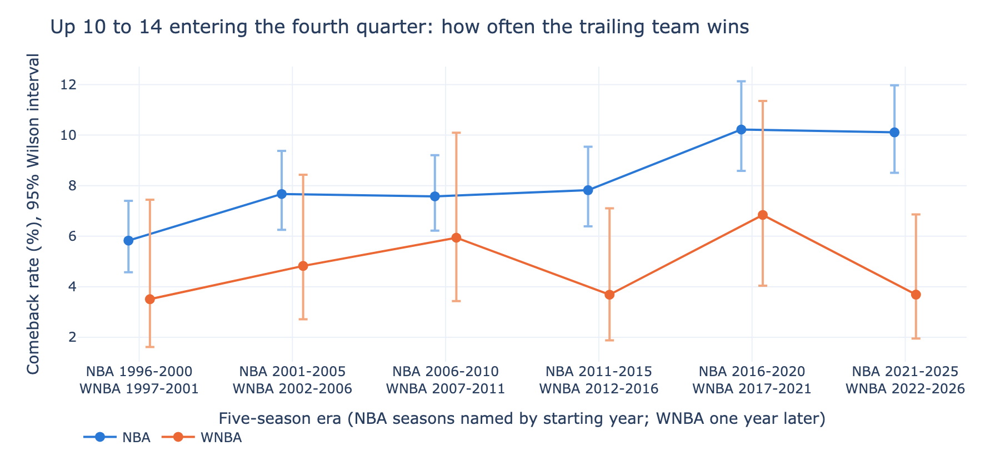
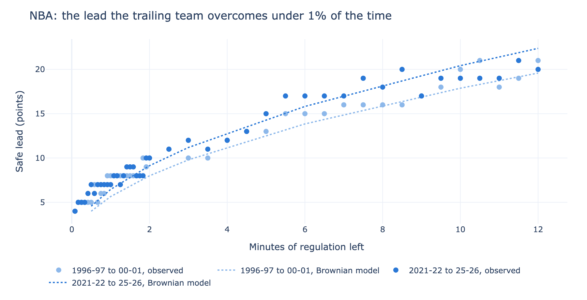
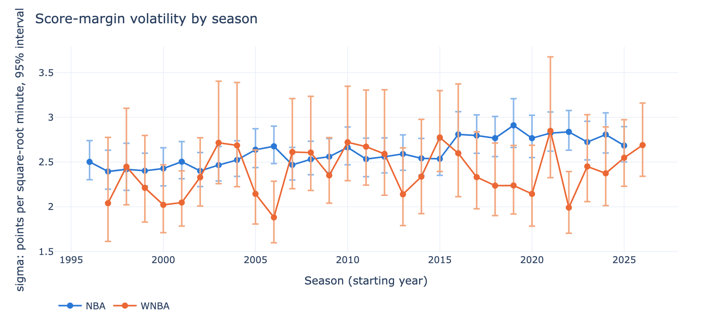

# Safe-lead study

How big a lead is safe, with a given amount of time left, and has that
changed? This study answers it for every NBA regular-season game from
1996-97 to 2025-26 and every WNBA regular-season game from 1997 to 2026,
from the score at checkpoints through each game (every 5 seconds over the
last two minutes, every 30 seconds before that).

Two methods, each with a different claim:

1. **Observed comebacks.** The share of games the trailing team went on to
   win, by lead, time left, and five-season era. Rates are smoothed so they
   never rise with the lead (PAVA), with Wilson intervals. "Safe" means a
   comeback under 1% (5% and 10% are in the outputs). The era comparison
   uses fixed game situations, where the data are dense, with Newcombe
   intervals on the change.
2. **Stern's Brownian-motion model** (Stern 1994, JASA 89:1128-1134). The
   score margin as a random walk with one volatility per era, sigma, fitted
   by probit with game-clustered standard errors. It gives a smooth safe-lead
   curve, z times sigma times the square root of minutes left, and a
   calibration table shows where it fails.

Design, decisions, and data checks: `docs/design.md`. Data sources and
licenses: `DATA_SOURCES.md`. Private repo; not yet on the family hub.

## Results

<!-- gen:results -->
Coverage: 35,492 NBA games (1996-97 to 2025-26) and 6,469 WNBA games (1997 to 2026), every regular-season game whose final score matches LeagueGameLog and whose running score never jumps by more than one basket; 55 NBA and 27 WNBA games fail those checks and are left out (per season in `output/coverage.csv`). Every table below is computed twice, in Python and in R from the same events, and the two agree on every cell (`python/04_reconcile.py`).

### 1. How often a fixed lead is lost, then and now

Share of games the trailing team won, first five-season era against the last, with the change in percentage points and its 95% Newcombe interval (in brackets: Bonferroni-adjusted for all 12 comparisons):

| Situation | League | First era | Last era | Change (points) |
|---|---|---|---|---|
| halftime, up 10-14 | NBA | 15.5% | 18.2% | +2.7 (-0.4 to +5.7) [-1.8 to +7.1] |
| halftime, up 10-14 | WNBA | 12.2% | 13.6% | +1.5 (-5.6 to +7.8) [-9.2 to +10.6] |
| start of Q4, up 10-14 | NBA | 5.8% | 10.1% | +4.3 (+2.0 to +6.5) [+1.0 to +7.6] |
| start of Q4, up 10-14 | WNBA | 3.5% | 3.7% | +0.2 (-4.1 to +3.9) [-6.8 to +5.9] |
| start of Q4, up 15-19 | NBA | 1.9% | 3.5% | +1.5 (-0.2 to +3.3) [-1.1 to +4.1] |
| start of Q4, up 15-19 | WNBA | 1.9% | 0.6% | -1.3 (-5.9 to +1.8) [-9.6 to +4.1] |
| 6:00 left, up 10-14 | NBA | 2.5% | 4.8% | +2.4 (+0.8 to +4.0) [-0.0 to +4.8] |
| 6:00 left, up 10-14 | WNBA | 1.7% | 3.5% | +1.8 (-1.9 to +5.0) [-4.3 to +6.9] |
| 3:00 left, up 7-9 | NBA | 3.6% | 5.2% | +1.5 (-0.5 to +3.6) [-1.5 to +4.7] |
| 3:00 left, up 7-9 | WNBA | 1.5% | 3.9% | +2.4 (-2.0 to +6.4) [-5.0 to +9.0] |
| 1:00 left, up 5-6 | NBA | 1.7% | 3.9% | +2.2 (+0.4 to +4.2) [-0.6 to +5.3] |
| 1:00 left, up 5-6 | WNBA | 0.0% | 2.9% | +2.9 (-1.6 to +7.3) [-5.9 to +10.5] |

In the NBA, 3 of 6 situations show a rise whose interval excludes zero (start of Q4, up 10-14; 6:00 left, up 10-14; 1:00 left, up 5-6); after the adjustment, 1 remains (start of Q4, up 10-14). A 10 to 14 point lead entering the fourth quarter was lost 5.8% of the time in 1996-97 to 2000-01 and 10.1% in 2021-22 to 2025-26; the largest step between neighboring eras is into 2016-17 to 2020-21 (7.8% to 10.2%). In the WNBA, 0 of 6 situations show a change whose interval excludes zero; its samples in these situations are 18% the size of the NBA's, so changes as large as the NBA's cannot be ruled out either.



### 2. Safe leads (comeback under 1%)

Observed (PAVA-smoothed) 1% safe lead, with the range from the Wilson bounds of its PAVA block; "n/c" means the games at that lead are too few to certify 1% even at zero comebacks (the upper bound never falls below 1%):

**NBA**

| Era | 12:00 left | 6:00 left | 3:00 left | 1:00 left | 0:30 left |
|---|---|---|---|---|---|
| 1996-97 to 2000-01 | 21 (17 to 21) | 15 (13 to 17) | 10 (9 to 15) | 8 (6 to 11) | 5 (5 to 9) |
| 2001-02 to 2005-06 | 20 (15 to n/c) | 12 (12 to 16) | 11 (9 to 11) | 7 (7 to 11) | 6 (5 to 8) |
| 2006-07 to 2010-11 | 18 (18 to 22) | 12 (12 to 16) | 10 (9 to 10) | 8 (6 to 8) | 6 (6 to 9) |
| 2011-12 to 2015-16 | 19 (18 to 21) | 16 (13 to 17) | 11 (10 to 12) | 8 (6 to 10) | 6 (5 to 8) |
| 2016-17 to 2020-21 | 20 (20 to n/c) | 18 (17 to 18) | 12 (12 to 12) | 9 (6 to 10) | 6 (6 to 8) |
| 2021-22 to 2025-26 | 20 (18 to 23) | 17 (13 to 19) | 12 (10 to 15) | 7 (6 to 10) | 7 (5 to 7) |

**WNBA**

| Era | 10:00 left | 6:00 left | 3:00 left | 1:00 left | 0:30 left |
|---|---|---|---|---|---|
| 1997 to 2001 | 17 (13 to n/c) | 13 (10 to n/c) | 9 (6 to 9) | 5 (5 to 5) | 7 (4 to 7) |
| 2002 to 2006 | 13 (13 to n/c) | 13 (11 to n/c) | 12 (6 to n/c) | 7 (4 to 9) | 5 (4 to 5) |
| 2007 to 2011 | 20 (17 to n/c) | 13 (11 to n/c) | 9 (7 to 9) | 6 (6 to 10) | 6 (6 to 6) |
| 2012 to 2016 | 20 (14 to n/c) | 14 (10 to n/c) | 10 (10 to 10) | 7 (7 to 7) | 8 (5 to 8) |
| 2017 to 2021 | 12 (12 to n/c) | 9 (9 to n/c) | 11 (9 to 11) | 7 (6 to 7) | 6 (4 to 6) |
| 2022 to 2026 | 15 (11 to n/c) | 12 (12 to 14) | 12 (9 to 12) | 7 (7 to 7) | 6 (4 to 6) |

Single cells are noisy (a lead safe at 6:00 can read lower than at 3:00), because the 1% tail rests on a few hundred games per cell; the era comparison in section 1 uses the far denser middle of the distribution for that reason.



### 3. The Brownian-motion model, and where it fails

Fitted margin volatility, sigma, in points per square-root minute (95% interval, game-clustered), and the model's 1% safe lead at the start of the fourth quarter:

| League | Era | sigma | 1% safe lead at the start of Q4 |
|---|---|---|---|
| NBA | 1996-97 to 2000-01 | 2.43 (2.34 to 2.53) | 19.6 (18.8 to 20.4) |
| NBA | 2001-02 to 2005-06 | 2.51 (2.42 to 2.60) | 20.2 (19.5 to 21.0) |
| NBA | 2006-07 to 2010-11 | 2.58 (2.50 to 2.67) | 20.8 (20.1 to 21.5) |
| NBA | 2011-12 to 2015-16 | 2.55 (2.47 to 2.65) | 20.6 (19.9 to 21.3) |
| NBA | 2016-17 to 2020-21 | 2.81 (2.71 to 2.92) | 22.6 (21.8 to 23.5) |
| NBA | 2021-22 to 2025-26 | 2.78 (2.68 to 2.88) | 22.4 (21.6 to 23.2) |
| WNBA | 1997 to 2001 | 2.14 (1.96 to 2.34) | 15.7 (14.4 to 17.2) |
| WNBA | 2002 to 2006 | 2.35 (2.16 to 2.57) | 17.3 (15.9 to 18.9) |
| WNBA | 2007 to 2011 | 2.59 (2.39 to 2.82) | 19.1 (17.6 to 20.8) |
| WNBA | 2012 to 2016 | 2.49 (2.28 to 2.74) | 18.3 (16.8 to 20.1) |
| WNBA | 2017 to 2021 | 2.38 (2.19 to 2.61) | 17.5 (16.1 to 19.2) |
| WNBA | 2022 to 2026 | 2.44 (2.27 to 2.64) | 18.0 (16.7 to 19.4) |

NBA sigma went from 2.43 to 2.78, and the intervals of the first and last eras do not overlap; in the WNBA (2.14 to 2.44) they overlap. The model is a smooth summary, not a calculator for the endgame. In the NBA's last minute, leads of 7 to 10 are overturned 0.17% of the time against the model's 0.03% (6.2 times as often): fouling, threes, and timeouts add variance a constant-rate model has no room for. With 6 to 12 minutes left, leads of 16 or more are overturned 0.54% against 0.79% predicted: big leads belong disproportionately to better teams, which a model with no drift ignores (an interpretation, not tested here). Full calibration table: `output/brownian_calibration.csv`.


<!-- /gen:results -->

## Limits

- Regular season only. Playoff games are in the shared archive but are a
  different population (better teams, no tanking, rest days).
- "Safe" is unconditional: it does not know which team is better. A strong
  team's 10-point lead is safer than the table says, and a weak team's less
  safe.
- Checkpoints from one game are correlated. The Brownian standard errors are
  clustered by game; the empirical intervals at one checkpoint use one row
  per game, so they are not affected.
- The running score comes from PlayByPlayV3 score stamps. Games whose final
  differs from LeagueGameLog, or whose score jumps by more than one basket on
  one row, are left out; a stamp that is wrong by exactly two or three points
  would pass both checks.
- Eras are fixed five-season blocks, chosen before looking at results, not
  fitted break points.

## Reproduce

The events come from the family's shared PlayByPlayV3 layer
(`../basketball-analysis-tools/pbp_history.py`), which downloads the
shufinskiy/nba_data archives and checks every game against LeagueGameLog.

```bash
cd ../basketball-analysis-tools
python pbp_history.py build --league nba --years 1996-2025
python pbp_history.py build --league wnba --years 1997-2026
cd ../safe-lead-study
python python/01_checkpoints.py   # game states at every checkpoint
python python/02_empirical.py     # tier 1: observed comebacks and safe leads
python python/03_brownian.py      # tier 2: Brownian-motion fits
Rscript R/safe_lead.R             # the same, independently, in R
python python/04_reconcile.py     # Python against R, every cell
python python/05_figures.py       # figures/
python python/06_report.py        # this README's results
bash run_checks.sh                # every gate
```

Raw play-by-play stays local (NBA.com terms); `output/` holds aggregate
tables only.
